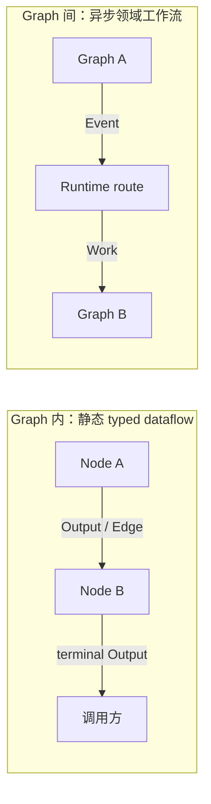
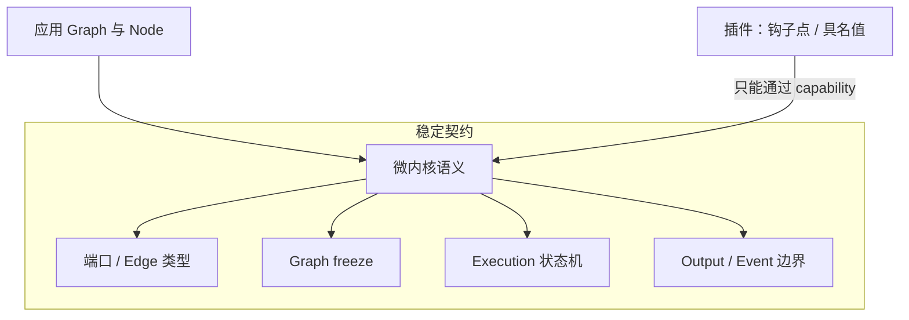

# 第一章：设计哲学与心智模型

本章先回答两个问题：Interlace 试图解决什么，以及为什么它选择现在这组概念。理解这两个问题后，后续 API 会更容易
记忆，因为它们都从同一套边界推导出来。

## 一句话定义

Interlace 是一个 typed graph runtime：一张 Graph 描述一次局部计算，多张 Graph 通过领域 Event 连接成工作流。

核心设计原则是：

> 内核语义固定，非本质能力可插拔；局部计算用 Graph，跨图协作用 Event。

## 为什么要区分两种流动

数据在同一张 Graph 内流动时，连接关系是静态的，类型可以提前校验，执行过程也可以从图结构推导。这里使用
`Output` 和 `Edge`。

跨 Graph 协作表达的是领域事实，例如“订单已创建”或“页面已抓取”。它可能启动零个、一个或多个后续工作，部署
位置和执行时间也不属于源 Graph。这里使用 `Event`。

两条通路不会隐式转换：

- Node 返回的 Output 不会自动发布成 Event；
- Event payload 不会自动进入某条 Edge；
- Graph 不直接引用或调用另一张 Graph；
- 目标 Graph 不在源 Node 的 `emit()` 调用栈中执行。

这个边界让单张 Graph 保持可推理，也让跨 Graph 工作流可以独立扩展和部署。

## 按层暴露的概念

概念是“必须知道才能用”的东西：能做成方法、参数或返回值的，就不要求用户导入一个类名。能力靠组合少数原语获得，
不为每个场景新增机制。每一层只比上一层多一两个概念：

| 层次 | 读者 | 需要理解的概念 | 其余能力从哪里来 |
| --- | --- | --- | --- |
| 写业务 | 所有人 | `Graph`、`Node`、`Output`、`Runtime` | `Context` 作为参数传入，跨图事实经 `context.emit()` 发出 |
| 编排 | 所有人 | 不新增 | `connect`、`on`、`emit`、`plan()`、`iter()` 与 `options=`、`slots=`、`timeout=` 等参数 |
| 扩展 | 插件作者 | 钩子点、插件 | 插件是 `setup(api)`，只有 `on`、`provide`、`wrap`、`require`、`defer` 五个动作 |
| 换基础设施 | 适配器作者 | SPI 协议 | `interlace.spi` 中的窄协议，普通用户看不到 |

顶层 `interlace` 因此只有 `Graph`、`Node`、`Output`、`Runtime`、`Context`、`Event` 六个名字。汇聚策略
`InputPolicy`、显式连接 `Edge`、执行计划 `ExecutionPlan`、执行句柄 `Execution` 与跨队列共享的 `SlotPool` 位于
`interlace.engine`，只在需要时导入。

## 微内核：哪些东西不能被插件改变

以下语义共同定义了“什么是 Interlace Graph”，因此属于微内核：

- 端口的类型约束；
- Graph 的冻结、可达性和 Edge 校验；
- InputPolicy 的 token 消费规则；
- Output 的局部传播；
- Event 与 Graph 数据流的边界；
- Execution 的状态、步数、超时、取消和错误语义。

如果插件可以改写这些规则，同一张 Graph 在不同环境中就可能具有不同含义，静态校验也会失去价值。
稳定的是公共契约，不是默认实现。满足相同契约的执行器、Router、Worker、Slot 池、输出存储和通知机制都可以
通过公开协议替换；应用仍使用同一套 Graph、Event 和 Execution 模型。

## 可插拔能力：哪些东西允许变化

部署环境和横切能力变化频繁，适合通过窄协议或统一的扩展机制变化：

- EventBus 与任务传输；
- GraphExecutor；
- RouterRole、WorkerRole 和 SlotProvider；
- ExecutionFactory、OutputStore 和 ExecutionNotifier；
- 按名称提供的输入 selector 等具名值；
- 核心钩子点上的处理函数：事件改写、Work 路由、交付与执行中间件、节点中间件、只读生命周期事实；
- 插件为领域定义的钩子点，以及领域 Node 和状态适配器。

扩展只有一套机制：两种钩子点（只读 Notice 与中间件 Wrap）加按名称提供、可装饰的具名值，核心与插件以同一方式
定义和使用。默认内存实现也由 `LocalInfrastructurePlugin` 与 `LocalRuntimePlugin` 通过 `PluginHost` 安装，与应用插件
走同一套依赖、具名值和清理路径。插件只能通过钩子点与具名值扩展，不能访问 Runtime 私有状态或改写微内核规则；
钩子点也不能吞掉执行控制异常或产生违反端口契约的结果。

## Less is more

顶层 API 只保留建立和运行工作流所需的对象。Work、Delivery、Router、Worker、Backend 和 PluginHost 虽然在实现中
存在，但普通用户不需要逐项组装。

这条原则也决定了框架的失败方式：错误配置应尽早、明确地失败，而不是通过隐式转换、默认重试或兼容分支猜测
调用方意图。

## 可靠性边界

默认实现是单进程内存运行时，不宣称持久化、broker ack、跨进程恢复、定时调度、死信队列或 exactly-once。
事件被接受后不会因为源 Graph 随后失败而撤回。外部副作用的幂等、领域去重和业务重试应由领域 Graph、Store 或
明确声明这些语义的后端实现。

## 接下来怎么读

下一章会运行第一张 Graph。之后分别深入 Graph 内的数据流和 Graph 间的事件流，再讨论 Execution、内部架构与
插件开发。

[下一章：第一张 Graph](02-first-graph.md)
