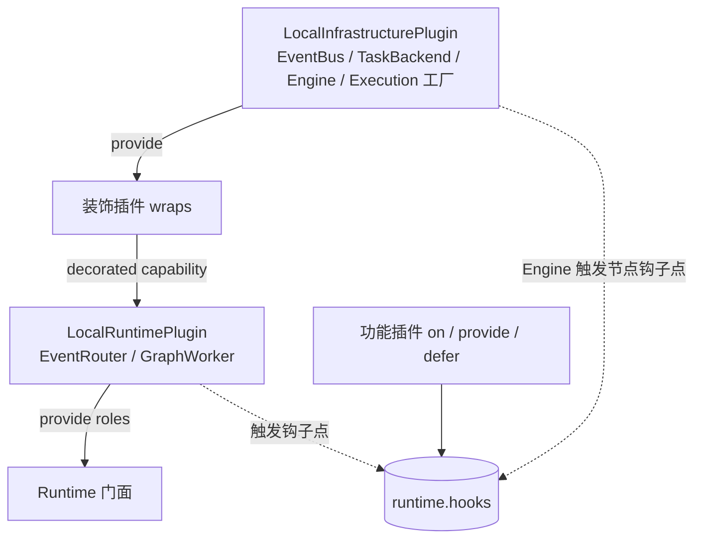
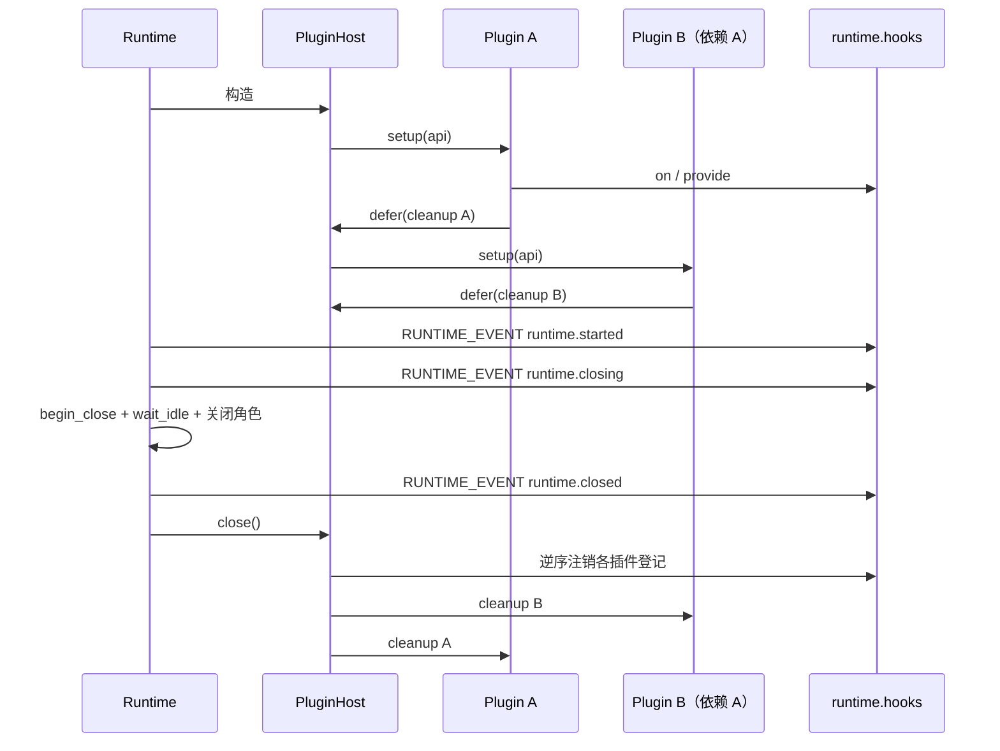
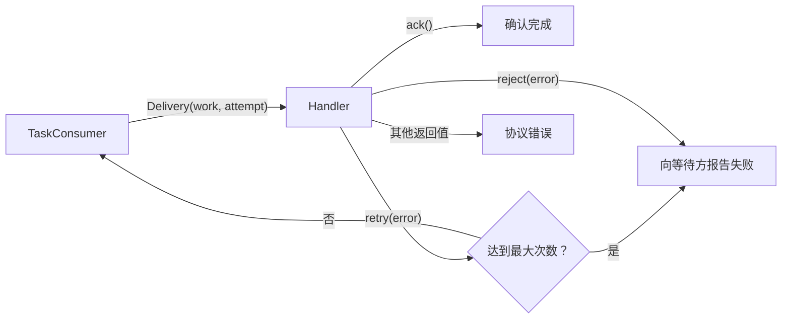

# 第七章：插件、SPI 与适配器开发

本章面向插件作者和基础设施适配器作者。开始前应先理解[Runtime 内部架构](06-runtime-architecture.md)中的角色与
能力端口；普通业务 Graph 不需要使用本章 API。

## 一种扩展机制

Interlace 的扩展只有一套机制，由两类扩展物组成，核心与插件使用完全相同的方式：

| 扩展物 | 作用 | 典型用途 |
| --- | --- | --- |
| 钩子点 | 在执行边界观察或包裹一次操作 | 缓存短路、重试、限流、追踪、改写 Work、生命周期资源 |
| 具名值 | 按命名空间名称提供可查找的实现；声明为单例 capability 的名称还可以被层层装饰 | 输入 selector、EventBus、TaskBackend、执行器、Router、Worker |

钩子点只有两种模式，每个点在定义时就固定模式和作用域键：

| 模式 | 处理函数签名 | 语义 |
| --- | --- | --- |
| `NoticePoint` | `fn(value) -> None` | 只读通知；失败写入日志后隔离，不影响业务 |
| `WrapPoint` | `fn(value, call_next) -> result` | 中间件：先登记者在外层，可改参、短路、重试、改写结果，抛出异常即拒绝本次操作 |

只改值的中间件写成 `lambda value, call_next: call_next(change(value))`。`WrapPoint(value_type=...)` 声明交给最内层操作
的值必须满足的类型，中间件传错类型时立即失败。

全部登记都保存在 Runtime 唯一的 `HookBus`（`runtime.hooks`）上。登记随时可以进行，返回统一的 `Registration`，
它可调用、可作上下文管理器，注销是幂等的。每次调用读取当时的登记快照，进行中的调用不受并发登记或注销影响；
节点中间件按 execution 取快照，新登记从下一次 execution 生效。

```python
from interlace import Runtime
from interlace.plugins import plugin
from interlace.plugins.points import NODE_CALL, RUNTIME_EVENT, WORK_ROUTE


@plugin("acme/crawl")
def crawl(api):
    api.on(NODE_CALL, request_cache, graph="crawl.graph", node="request")
    api.on(WORK_ROUTE, stable_work_id, queue="pages")
    api.on(RUNTIME_EVENT, export_metrics)
    api.provide("acme.crawl/ready", ready_selector)


runtime = Runtime(plugins=(crawl,))
temporary = runtime.hooks.on(RUNTIME_EVENT, debug_print)  # 运行期临时登记
temporary.detach()
```

`on()` 的关键字参数是作用域过滤条件：只有调用时对应作用域值相等的处理函数才生效。作用域键由钩子点声明，
登记未声明的键会立即失败。

### 控制异常不能被吞掉

Wrap 中间件可以捕获 `call_next` 抛出的普通异常来恢复业务失败，但执行控制异常（取消、超时、步数与队列上限）、
非 `Exception` 的 `BaseException` 以及节点层的 Engine 契约错误和 `StopGraph` 不能被吞掉：中间件吞掉或替换它们时，
宿主在交付任何替代结果之前重新抛出原异常。

### 插件定义自己的钩子点

插件可以定义领域钩子点，其他插件挂接，领域代码通过 `Context.hooks` 触发。`Context.hooks` 是只能触发、不能登记的
`HookCaller`，同时提供 `anotify/awrap` 异步入口，异步入口接受同步与异步处理函数：

```python
from interlace.plugins import WrapPoint

DOWNLOAD = WrapPoint("acme.http/download", scope=("site",))


class Download(Node):
    async def execute(self, inputs, context):
        response = await context.hooks.awrap(
            DOWNLOAD, inputs["request"], self.client.fetch, site=inputs["request"].site
        )
        return Output(response, "response")


@plugin("acme/retry", requires=("acme/http",))
def retry(api):
    api.on(DOWNLOAD, retry_on_timeout, site="example.com")
```

同步入口 `notify/wrap` 拒绝返回 awaitable 的处理函数，避免协程被静默丢弃。

## 插件

插件是一个带 `PluginDescriptor` 的对象加一个 `setup(api)`；函数插件与类插件能力完全相同。简单插件用 `@plugin(...)`
装饰一个 `setup(api)` 函数即可。需要在关闭时释放的资源，创建后立即用 `api.defer` 登记清理：

```python
@plugin("acme/tracing", requires=("acme/metrics",))
def tracing(api):
    exporter = make_exporter()
    api.defer(exporter.close)  # 关闭或启动回滚时逆序执行
    api.on(RUNTIME_EVENT, exporter.record)
    api.on(RUNTIME_EVENT, lambda event: exporter.flush(), kind="runtime.started")
```

需要在全部插件装配完成后才执行的逻辑，订阅 `RUNTIME_EVENT` 的 `runtime.started`。`ExtensionAPI` 只有五个动作：

| 方法 | 作用 | 可用阶段 |
| --- | --- | --- |
| `on(point, handler, **scope)` | 在钩子点登记处理函数 | 随时 |
| `provide(name, value)` | 提供具名值；名称在 `provides` 中声明时是单例 capability | capability 只在 setup；其他名称随时 |
| `wrap(capability, decorator)` | 装饰已在 `wraps` 声明的单例，`decorator(inner) -> outer` | setup |
| `require(name)` | 取得具名值，capability 返回经全部装饰后的实现 | 随时 |
| `defer(cleanup)` | 登记关闭或启动回滚时逆序执行的清理函数 | 宿主关闭前 |

另有只读属性 `hooks`，返回 Runtime 的钩子总线，用于构造需要触发钩子点的替代组件。

`PluginDescriptor(id, version="1.0.0", *, requires, provides, wraps, requires_capabilities, api_version="4")` 中，插件 ID
与具名值名称都必须带命名空间。`requires` 声明插件依赖，`requires_capabilities` 声明单例依赖；宿主据此拓扑
排序，并保证 capability 的提供者先于全部装饰者、全部装饰者先于其余依赖方，同一 capability 的多个装饰者按传入
顺序装配，后装配者位于外层。缺失或循环依赖、API 版本不兼容、能力冲突、装饰无人提供的能力，以及 setup 后未兑现
`provides` 或 `wraps` 声明，都会在 Runtime 构造期间失败。只有声明者能提供已声明的 capability；未声明的名称（例如
输入 selector）任何插件都可以在任何时候提供，同名重复提供立即失败。插件以 `api.on`/`api.provide` 登记的内容
属于该插件，宿主关闭或启动回滚时统一注销。

`PluginHost` 只装配显式传入的可信 Python 插件，不扫描环境，也不在 import 时自动执行第三方代码。需要配置驱动
发现时，应在应用 composition root 中完成包发现和白名单选择，再把实例交给 Runtime。

## 默认装配与替换

Runtime 的全部组件都由插件提供。传入的插件未提供的角色由 `LocalRuntimePlugin` 补齐，补齐角色所需、或任一插件依赖
或装饰但无人提供的基础设施由 `LocalInfrastructurePlugin` 补齐。默认内存组合因此只是两个普通内建插件：



只替换一项基础设施时，插件只声明自己提供的 capability：

```python
@plugin("acme/redis-events", provides=(CAP_EVENT_BUS,))
def redis_events(api):
    events = RedisEventBus(client)
    api.defer(events.close)
    api.provide(CAP_EVENT_BUS, events)
```

一次注入多项现成组件时可以直接配置内建基础设施插件；注入组件默认由调用方管理，`close_injected=True` 才由插件关闭：

```python
from interlace.runtime import LocalInfrastructurePlugin, LocalRuntimePlugin

runtime = Runtime(
    plugins=(
        LocalInfrastructurePlugin(tasks=my_task_backend),
        LocalRuntimePlugin(history_limit=200, direct_workers=8),
    )
)
```

注入的 `Engine` 必须与 Runtime 共享钩子总线，否则节点中间件与采集不会生效，装配时会明确失败：

```python
bus = HookBus()
runtime = Runtime(
    plugins=(LocalInfrastructurePlugin(executor=Engine(hooks=bus)),), hooks=bus
)
```

装饰已有能力不需要重新实现它，例如为任务后端加上指标统计：

```python
@plugin("acme/task-metrics", wraps=(CAP_TASK_BACKEND,))
def task_metrics(api):
    api.wrap(CAP_TASK_BACKEND, lambda inner: MeteredTasks(inner, registry))
```

Router 与 Worker 可以各自独立替换或装饰。只提供其中一个角色的插件声明所需依赖，其余部分由默认插件补齐；替代角色
应在 setup 中用 `api.hooks` 构造，从而与其他插件登记的钩子、selector 共享同一总线：

```python
@plugin(
    "acme/worker",
    provides=(CAP_GRAPH_WORKER,),
    requires_capabilities=(CAP_EVENT_ROUTER, CAP_TASK_BACKEND, CAP_GRAPH_EXECUTOR),
)
def worker(api):
    router = api.require(CAP_EVENT_ROUTER)
    api.provide(
        CAP_GRAPH_WORKER,
        MyWorker(
            consumer=api.require(CAP_TASK_BACKEND),
            executor=api.require(CAP_GRAPH_EXECUTOR),
            emit=router.publish,
            emit_local=router.publish_local,
            hooks=api.hooks,
        ),
    )
```

`EventRouter`、`GraphWorker` 和底层协议是高级组合接口，不属于顶层 `interlace` 公共 API。

窄角色协议从 `interlace.spi` 导入，随包提供的本地实现从 `interlace.adapters` 导入：

```python
from interlace.adapters import memory
from interlace.spi import EventBus, GraphExecutor, TaskConsumer, TaskPublisher

events = memory.EventBus()
tasks = memory.TaskBackend()
```

`interlace.spi` 只定义角色和跨适配器数据模型；`interlace.adapters` 只放具体部署实现。`TaskBackend` 仅是
`TaskPublisher` 与 `TaskConsumer` 的便利组合，不代表 EventBus 或 GraphExecutor。

| 协议 | 负责什么 | 默认实现 |
| --- | --- | --- |
| `EventBus` | Event 订阅、发布、投递空闲与关闭 | `memory.EventBus` |
| `TaskPublisher` | 向命名队列提交 Work | `memory.TaskBackend` |
| `LocalTaskPublisher` | 可选：在当前进程延续 Slot lease | `memory.TaskBackend` |
| `SlotLease` | 引用管理、读取 Slot 和串行 execution | 由 `SlotPool` 返回 |
| `TaskConsumer` | 调度带 Slot 的 Work，并控制当前实例的本地并发 | `memory.TaskBackend` |
| `TaskBackend` | 同时实现发布与消费的组合协议 | `memory.TaskBackend` |
| `SlotProvider` | 申请资源、查询容量和可用通知 | `SlotPool` |
| `RouterRole` / `WorkerRole` | Runtime 所依赖的事件与执行角色；RouterRole 提供 `publish`/`publish_local`，WorkerRole 即 `ExecutionHost` | EventRouter / GraphWorker |
| `GraphExecutor` | 执行已冻结 Graph，通过 Execution 交付终端 Output | `Engine` |
| `ContextFactory` | 从基础 Context 与当前输入创建领域 Context，通过 Graph 配置 | `Context.make` |
| `ExecutionFactory` | 为每次直接执行和 Work 创建独立句柄及资源 | `Execution` 构造器 |
| `OutputStore` | 顺序追加、按索引重放终端输出 | MemoryOutputStore |
| `ExecutionNotifier` | 同步和异步等待的版本化唤醒 | LocalExecutionNotifier |

## 适配器的最低要求

EventBus 和 TaskConsumer 必须实现 `idle`、`wait_idle(timeout)` 和 `close()` 所表达的本实例生命周期语义；
TaskPublisher 的 `submit()` 正常返回即表示后端已接受 Work，同时提供 `close()` 释放发布端资源。GraphExecutor
提供 `execute()` 和 `close()`。角色依赖这些方法完成自身的等待与关闭。

- EventBus 的 `subscribe(event_type, handler, subscription=...)` 需要支持精确类型和 `"*"` 通配订阅。同名
    subscription 的多个实例竞争消费，不同 subscription 各自收到一份；省略 subscription 的观察者相互独立。
    返回的 `Callable[[], None]` 必须幂等且只注销本次注册；同一个 handler 的其他注册保持有效。注销后不再选择
    该注册，已经选中的投递仍然完成。Event 始终只有 `type` 和 `payload`，EventBus 不接触 Slot 或 lease。
- TaskPublisher 把 Work 提交到命名 queue，`submit()` 正常返回表示后端已经接受；同一进程内 TaskConsumer 的
    `bind(queue, handler, concurrency=..., slots=...)` 在调度根 Work 前通过 `slots.try_acquire()` 获取 lease。Work 只包含 Graph
    名、输入、领域 trigger、ID、limits 和 options；进程内 lease 只存在于 `Delivery.slot_lease`。支持 `LocalTaskPublisher` 的本地后端
    可以延续 lease；等待 Slot 的根 Work 不能占用 concurrency，交付完成或失败后必须释放 Delivery 持有的 lease。
    `bind()` 返回幂等的 `Callable[[], None]`：按适配器声明的排空范围结束本次绑定，等待交付完成最终 lease 清理，
    再释放该绑定的资源；不得注销同一 queue 的其他消费者。绑定失败需要移除本次注册并清理已经创建的资源。
- GraphExecutor 接收注册名、冻结 Graph、入口输入、Event emitter、可选 ExecutionPlan，以及可选 `slot=`、`options=` 和必需的
  `execution=`。GraphWorker 会把冻结后的 Node timeout 快照绑定到 Execution 并开始执行；替换执行器必须为每次
  Node firing 使用 `with execution.step(node_id): ...` 包住完整调用，并在调度边界调用
  `execution.checkpoint()`，从而保留步数、取消和 timeout 语义。在该边界内绑定基础 Context，并通过
  `graph.context_factory(base, inputs)` 创建节点与 Hook 共用的领域上下文；工厂约束见
  [领域 Context 工厂与组合](05-execution.md#领域-context-工厂与组合)。终端输出逐项调用 `execution.publish_output(output)`，
  异步执行器使用 `await execution.apublish_output(output)` 避免背压阻塞事件循环。同步执行返回 None，异步执行返回
  Awaitable[None]，不得返回结果 tuple；所有结果都来自同一输出存储。需要节点中间件、采集与生命周期通知的执行器在
  构造时从 `api.hooks` 取得钩子总线，按下文的节点钩子点语义调用。

可参考 [test_runtime_spi.py](../tests/engine/test_runtime_spi.py) 中的同步替身：它验证三个能力可独立替换，也验证
Runtime 不依赖默认内存实现的私有字段。

## 核心实现的替换

`RouterRole`、`WorkerRole` 是结构化协议，替换角色无需继承 EventRouter 或 GraphWorker。WorkerRole 即 `ExecutionHost`：
注册、消费、执行、等待、`begin_close()` 与关闭；RouterRole 提供观察、路由、发布（含 `publish_local`）、等待与关闭。
扩展行为不属于角色协议，统一经钩子总线完成，因此替代角色只要以 `api.hooks` 构造，就自动支持全部插件。
`observe()`、`route()` 与 `consume()` 返回独立幂等的注销函数；`consume()` 撤销本次调用新建的消费者绑定及其自建
SlotPool，队列此前已由相同配置消费时为空操作。`begin_close()` 拒绝新的直接执行并解除未结束执行的输出背压，
使未读取的订阅不能阻止 Runtime 排空。

WorkerRole 的基本执行入口是 `start()`，同步 `Runtime.run()` 和异步 `Runtime.arun()` 分别等待它返回的同一个
Execution。`iter()`、`aiter()` 必须先建立输出订阅再启动执行，保证首批输出也受到背压约束。替换 Worker 仍须在注册时
以 `hooks.provided()` 冻结 Graph、验证 ExecutionPlan，以 `WORK_DELIVER` 包裹交付、以 `EXECUTION_RUN`
包裹执行外层，并保持 Work 并发、Slot 链、错误传播和等待关闭的契约。

替换执行器可以通过 `graph.spec_for(node_id)` 读取冻结后的端口、输入策略和 timeout，通过 `graph.outgoing_for()`
读取原图连接；有计划时必须使用 `plan.entrypoint` 绑定输入与启动调度，使用 `plan.nodes` 和 `outgoing_for()`
选择节点与连接。不能继续按原图入口校验本次输入；计划出口与 diagnostics 已通过公开字段提供，不需要读取私有字段。
执行宿主调用 `execution.start(graph)` 开始计时，执行器正常完成后调用 `succeed()`，异常时调用 `fail(error)`。
`start()` 返回 False 表示句柄已在启动前取消，宿主不得继续执行。取消和 timeout 的解释仍由 Execution 统一负责。

`ExecutionFactory` 可以通过 LocalInfrastructurePlugin 的 `execution_factory=` 注入，也可以通过
`CAP_EXECUTION_FACTORY` capability 提供。其签名为：

```python
def make_execution(graph, *, limits, id=None, output_buffer=64):
    return Execution(
        graph,
        limits=limits,
        id=id,
        output_buffer=output_buffer,
        output_store=make_output_store(),
        notifier=make_notifier(),
    )
```

`make_output_store()` 和 `make_notifier()` 由应用实现；每次调用必须创建独立资源。工厂必须保留收到的 Graph 名、
Work ID、limits、output_buffer，并返回 PENDING 状态的 Execution。默认工厂也是经 LocalInfrastructurePlugin 装配的
普通 capability，没有为内存实现单独设置创建路径。

OutputStore 提供 `append(output)`、`len(store)` 和 `store[index]`。存储在绑定时必须为空，追加必须原子完成，已接受
输出必须保持顺序且可重复读取；不能通过丢弃旧输出来悄悄改变重放契约。存储资源的生命周期由提供工厂的应用或插件
管理，必须至少覆盖 Execution 的读取期。框架只在调用方请求完整结果时读取全量数据。

ExecutionNotifier 提供单调版本 `version`、`notify()`、`wait(version, timeout)` 和 `wait_async(version)`。
通知递增版本并唤醒全部等待者；等待旧版本应立即完成，等待当前版本必须允许后续跨线程通知唤醒。取消异步等待时
必须移除对应等待者，不能影响其他消费者。同步与异步输出接口在该通知机制上共享背压、取消和 timeout 规则。

[执行资源替换测试](../tests/engine/test_execution_extensions.py) 验证同步/异步第三方执行器、SQLite 输出存储和通知
注入；[角色与资源池替换测试](../tests/engine/test_role_extensions.py) 验证不继承默认类的角色组合及独立 SlotProvider。

## Slot 的公开资源接口

适配器从 `interlace.spi` 导入 `SlotProvider` 和 `SlotLease` 协议。默认 SlotPool 和第三方资源池经过相同的结构化检查，
适配器通过协议获取 lease，不构造内部 lease、不读取内部锁。

| 接口 | 契约 |
| --- | --- |
| `slots.try_acquire()` | 立即申请一个根执行链引用，池耗尽时返回 `None`；已关闭时抛 `SlotProviderClosedError` |
| `slots.acquire(timeout=None)` | 在调度控制线程中等待；超时抛 `TimeoutError`，零秒表示不等待 |
| `slots.subscribe_available(callback)` | 订阅 Slot 归还通知，返回幂等取消函数；通知不预留资源 |
| `lease.slot` | 读取执行链的 Slot，不转移引用所有权 |
| `lease.retain()` / `lease.release()` | 增加和释放引用；最后一个引用释放后归还 Slot |
| `lease.execution()` | 上下文管理器，串行执行同一 Slot 的 Graph，并在执行期间自动保留一个临时引用 |

根 Work 在分配到 lease 后才可占用 Consumer 的执行线程；没有可用 Slot 时保留在待调度队列中，并继续调度已经
携带 lease 的延续 Work。先注册可用通知，再尝试调度；通知只提示重新调用 `try_acquire()`，其他 Consumer 可能先取得
资源。回调应快速返回，抛出的普通异常会被记录并隔离，不影响归还和其他订阅者。关闭 Consumer 时取消自己的订阅。
`try_acquire()` 抛出 `SlotProviderClosedError`（同时是 `RuntimeError`）表示资源池已永久关闭：默认内存后端在通道全部消费者的
资源池都已关闭时，把无法再分配的队首根 Work 记为失败并移出队列，`wait_idle()` 与关闭不会永久等待；其他异常视为暂时失败，
Work 保留在队列中等待后续推进。

取得引用后，交付和释放遵循下面的所有权规则：

```python
from interlace.spi import Delivery

lease = slots.try_acquire()
if lease is not None:
    try:
        result = handler(Delivery(work, slot_lease=lease))
    finally:
        lease.release()
```

该片段表示已分配资源的交付边界；实际适配器仍须把 handler 调用调度到配置的执行线程，并处理 `DeliveryResult`。
GraphWorker 通过 `with lease.execution() as slot:` 包住完整 Graph execution；退出执行上下文只释放临时引用，
交付所持引用仍由 Consumer 在 `finally` 中释放。提交执行线程失败时，同样必须释放尚未交付的引用。
默认内存后端在 Work 入队后即接管引用；随后提交执行线程失败会释放该引用，并通过 `wait_idle()` 报告失败，
不会再让发布方误以为接管失败而重复释放。

每个分支、重投递或异步交接都必须有自己的引用。`LocalTaskPublisher.submit_local(queue, work, lease)` 正常返回时
接管调用方转交的一个引用，抛错时引用仍由调用方释放；接收方不能再次为同一交接重复 retain。Router 已为每个本地
分支 retain，Consumer 处理完该次交付后 release。lease 全部释放后，读取、retain、release 或再次进入 execution
都会被拒绝。池关闭后不接受申请和新订阅，并唤醒正在等待的申请；已持有的引用仍能执行和归还。

`SlotLease` 只属于当前进程，不参与 broker 租约或远程确认。远程适配器仅序列化 `Work`，接收进程从自己的 SlotPool
申请 lease，再创建 `Delivery(work, slot_lease=lease)`。不要序列化 Slot、SlotPool 或带 lease 的 Delivery。

[独立适配器契约测试](../tests/engine/test_slot_adapter.py) 展示了仅通过上述公开接口实现跨队列延续、分支引用和失败
归还；[Slot 契约测试](../tests/engine/test_slots.py) 验证池耗尽、关闭唤醒、执行互斥及错误释放。

## 语义必须由适配器声明

协议刻意没有规定序列化、持久化、确认或重试策略。因此 Redis、RabbitMQ、数据库任务表等适配器必须在自己的
文档中明确：

- 事件和 Work 的投递语义（至多一次、至少一次等）；
- 哪一方确认消息、何时重试、失败放到哪里；
- `wait_idle()` 在分布式场景下具体表示什么；
- `close()` 是停止接收、排空本地任务，还是等待远程 broker 完成；
- payload 的序列化限制，以及幂等性由谁保证。
- `Work.limits` 与 execution ID 如何跨进程传递，取消请求如何送达执行进程。

不要仅因适配器名为 Redis 或 MQ 就暗示这些能力已经存在。领域 ID、去重和外部副作用的幂等性仍应由领域模型
显式实现。

`Event` 和 `Work` 本身就是不含 lease 的传输模型。远程适配器必须序列化 Graph 名、输入、Work ID、limits、options 和领域
Event，并明确 payload 的编码限制；接收端 TaskConsumer 把反序列化后的 Work 作为新的本地根 Work，从本地
SlotPool 获取 Slot，再创建本地 Delivery。跨进程适配器不得序列化 Delivery 的 lease，也不得宣称延续了源进程的
Slot。

## 分离 Router 与 Worker

`route()` 只负责把 Event 转成 Work 并投递到 queue，`consume()` 只负责消费 queue 并执行 Work 指定的 Graph：

```python
# Router 不需要注册目标 Graph。
router = EventRouter(events=events, publisher=tasks)
router.route("order.created", graph="order.process", queue="orders")

# Worker 不需要订阅源 Event；同一 queue 可以启动多个 Worker 竞争消费。
worker = GraphWorker(consumer=tasks, emit=router.publish)
worker.register("order.process", order_graph)
worker.consume("orders", concurrency=8)
```

`route()` 默认生成稳定的 `route:{event_type}:{graph}:{queue}` subscription，也可通过 `subscription=` 显式指定。
多个 Router 注册同一条 route 时属于同一逻辑订阅，只应由其中一个实例投递 Work。

`on(event_type, graph=..., queue=..., concurrency=...)` 是 Runtime 上组合 `consume()` 与 `route()` 的常用入口。
它先准备本地消费者，再暴露 Event route，避免消费端配置失败后留下仍会投递 Work 的 route；返回的 `Registration`
先撤销路由再释放消费者。`observe(event_type, handler)` 独立用于观察 Event：观察者在发布线程内调用，抛出的普通异常
写入 `interlace.runtime.router` 日志后被隔离，不影响其他订阅者和 `emit()` 结果；观察者内部再次 `emit()` 不继承源
execution 的 Slot lease，产生的 Work 开始新的 Slot 链。`EVENT_EMIT`、`WORK_ROUTE` 中间件或 route 的 Work 提交
失败以 `EventDispatchError` 传回 `emit()` 调用方。Router 在把 Event 交给 EventBus 之前发布 `EVENT_PUBLISHED`，
因此它先于同一 Event 引起的 `WORK_SUBMITTED`；分发失败不撤回这条事实。

## 组件生命周期

PluginHost 按依赖顺序调用全部插件的 `setup()`，并在每个插件 setup 后核对 `provides` 与 `wraps` 都已兑现；全部完成后
capability 冻结。任何步骤失败都会先逆序注销各插件经 `api.on`/`api.provide` 的登记，再按登记的逆序执行全部
`api.defer` 清理函数（包括失败插件在失败前登记的清理）；单项清理失败不跳过后续步骤。启动回滚重新抛出原始失败，
清理失败全部写入 `interlace.plugins.host` 日志。

`Runtime.close()` 依次：进入 CLOSING 并发布 `runtime.closing`；调用 Worker 的 `begin_close()` 并排空已接受工作；
关闭 Worker 与 Router；发布 `runtime.closed`；最后关闭 PluginHost，按相同流程注销登记并执行清理，抛出首个清理失败
并记录其余失败。

capability 的 `provide()` 返回的 `Registration` 可在 setup 阶段撤销并重新提供，也可在关闭和启动回滚期间（包括 defer
清理内）撤销；宿主运行期间撤销会抛出 RuntimeError，避免已取得 capability 的组件看到它消失。未声明的具名值随时可以撤销。

插件构造器只保存配置，线程、连接等资源应在 `setup()` 中创建并立即 `defer` 清理。内建插件同样在 `setup()` 中创建默认
传输和 Engine，因此依赖校验失败不会启动后台线程；setup 中途失败时，已创建的资源也会被回收。



LocalInfrastructurePlugin 自己创建的 `memory.EventBus`、`memory.TaskBackend` 和 Engine 由插件关闭；通过其构造器注入的
组件默认由调用方管理，`close_injected=True` 才表示插件接管所有权。LocalRuntimePlugin 只关闭自己创建的角色。

EventRouter 和 GraphWorker 只自动关闭自己创建的默认组件。注入的 EventBus、TaskPublisher、TaskConsumer 和
GraphExecutor 默认由调用方管理，这使多个角色可以安全共享客户端或连接池。若注入组件明确由某个角色独占，
可对该角色传 `close_injected=True`。同一共享组件不要同时交给两个角色管理。

无论底层组件由谁拥有，角色都必须注销自身建立的注册。EventRouter 保存每次 `subscribe()` 返回的注销函数，
GraphWorker 保存每次 `bind()` 返回的注销函数；角色退出后，共享传输保留其他角色的订阅和消费者。
注销消费者时，handler 返回只代表业务处理结束，消费端仍须等待交付所持 lease 完成释放，才能关闭相应资源。
其他消费者仍使用同一 SlotProvider 时，必须保留它们需要的可用通知。

默认内存后端只向已有消费者的通道接受 Work：从未绑定消费者或最后一个消费者已经注销的通道，`submit()` 和
`submit_local()` 立即抛出 RuntimeError（`no active consumers`），Router 把它包装为 `EventDispatchError` 传回 `emit()`。
因此只建立 route 而未 `consume()` 时，`emit()` 立即失败，不会留下让 `wait_idle()` 或 `close()` 挂起的排队 Work。
最后一个消费者注销时，先排空该通道已接受的队列和在途交付，包括同通道续作及 lease 清理，再原子地完成退订；
新的消费者成功绑定后恢复接收，失败的绑定会被撤下。如果外部 Event 恰好在 Worker 完成退订、Router 尚未关闭的间隙
触发旧 route，任务提交同样明确失败。远程适配器应单独说明其退订与队列接收语义。

默认内存组件的 `close()` 可以并发调用：TaskBackend 先进入 CLOSING，拒绝新绑定但继续接受已有消费者通道的续作，
排空后在同一临界区撤下全部消费者，并发调用方等待同一次关闭完成；EventRouter 进入 CLOSING 后拒绝新的注册与发布。
memory.EventBus 的关闭是一次原子切换，不等待在途分发。

Runtime 关闭插件提供的 Router 与 Worker；角色底层注入组件是否被关闭仍由各自的 `close_injected` 或提供组件的插件决定。

TaskConsumer 的 `idle` 和 `wait_idle()` 只描述当前消费实例能够跟踪的工作，不是分布式系统的全局完成屏障。
TaskPublisher 的 `submit()` 正常返回只表示后端接受 Work，不等待远端消费者执行完成。

## 可确认的 Work 交付

TaskConsumer 向 handler 交付 `Delivery`，其中包含 `work` 和从 1 开始的 `attempt`。handler 返回：

- `DeliveryResult.ack()`：执行成功，可以确认；
- `DeliveryResult.retry(error)`：请求重新投递；
- `DeliveryResult.reject(error)`：永久拒绝，并向等待方报告错误。

默认内存适配器支持立即重试，默认最多交付 3 次，可用 `memory.TaskBackend(max_delivery_attempts=...)` 调整；通道已无
消费者时不再重排，直接记为失败。handler 必须返回一个 `DeliveryResult`；缺少返回值或返回其他类型属于协议错误。
交付失败只保留首个待传播异常，由下一次 `wait_idle()` 或 `close()` 抛出并清除；其间出现的其他失败在发生时写入
`interlace.adapters.memory` 的 ERROR 日志，不在内存中累积。

`Work.id` 同时作为本地 Execution ID。同一 id 的重投递（通常 attempt 更高）在前一次 Execution 已进入终态时替换其
保留记录，`get_execution(id)` 返回最新一次尝试；前一次仍在执行时 Worker 以 REJECT 拒绝本次交付，不并发执行同一 Work。
持久任务适配器应自行实现 consumer lease、visibility timeout、redelivery、最大重试次数和 dead-letter 策略；核心协议不宣称
这些能力已经由接口自动提供。



## 核心钩子点

核心钩子点从 `interlace.plugins.points` 导入，与插件自定义的钩子点使用同一机制：

| 钩子点 | 模式 | 作用域 | 位置与用途 |
| --- | --- | --- | --- |
| `EVENT_EMIT` | Wrap[Event → Event] | `event_type` | 包裹 Router 分发；改写或替换事件决定后续路由，不调用 `call_next` 即不分发，抛出异常即拒绝；返回值是 `emit()` 的结果 |
| `WORK_ROUTE` | Wrap[Work → None] | `event_type`, `graph`, `queue` | 包裹路由构造 Work 后的提交；设置稳定 `id`、注入 `options` 或 `limits`，不调用 `call_next` 即不提交 |
| `WORK_DELIVER` | Wrap[Delivery → DeliveryResult] | `queue`, `graph` | Worker 处理一次交付；可短路、计时、限流，或把失败改写为 `retry` |
| `EXECUTION_RUN` | Wrap[ExecutionCall → None] | `graph` | 直接执行与队列执行的公共外层；只能替换 `inputs` 与 `options` |
| `NODE_CALL` | 流式 Wrap[NodeCall → Outputs] | `graph`, `node` | 包裹一次 Node 调用，见下文 |
| `NODE_INSPECT` | Notice[NodeInspection] | `graph`, `node` | 实际调用边界的只读采集 |
| `RUNTIME_EVENT` | Notice[RuntimeEvent] | `kind`, `graph` | Runtime 启动与关闭，以及 execution、Node、Event 与 Work 的只读生命周期事实 |

`EVENT_EMIT` 与 `WORK_ROUTE` 声明了 `value_type`：中间件交给内层的不是 Event 或 Work 时，`emit()` 以
`EventDispatchError` 失败。`WORK_DELIVER` 中间件返回 `DeliveryResult`；抛出异常或返回其他类型时该交付被拒绝。它可以基于
`delivery.attempt` 返回 `DeliveryResult.retry(error)` 实现有界重试，交付次数上限仍由任务后端决定，中间件不能替换交付
携带的 Slot lease。`EXECUTION_RUN` 替换 execution、Graph、plan、slot 或 work 时执行以 `InterlaceRuntimeError` 失败。

`RUNTIME_EVENT` 不包含业务输入输出，处理函数抛出的异常写入日志后隔离，日志、Tracing 和指标插件因此不能改变
Graph 结果；以 `kind="execution.finished"`、`kind="runtime.started"` 等作用域只订阅某类事实。

## 输入选择器

自定义输入策略写成 `InputPolicy("namespace/name", {...})`，同名 selector 作为具名值提供：插件用
`api.provide("namespace/name", selector)`，运行期也可用 `runtime.hooks.provide(...)`。selector 实现
`interlace.spi.InputSelector`，只能读取端口名称、各端口可用 token 数和冻结配置，返回本次各消费一个 token 的端口元组
或 `None`。Graph 注册时以当时提供的具名值快照冻结；缺失、重复、空端口或不存在端口的选择都会失败，因此提供必须发生在
使用该策略的 Graph 注册之前。撤销后，新 Graph 冻结时无法再解析该名称，已冻结 Graph 继续使用原快照；旧句柄也不会影响
后来建立的同名提供。直接调用 `graph.freeze(selectors)` 或 `graph.plan(..., selectors=...)` 时传入同样的名称到实现映射；
已冻结 Graph 再传 `selectors=` 会抛出 `ValueError`。

## 节点中间件

`NODE_CALL` 处理函数签名为 `fn(call, call_next) -> Outputs`。`call_next(call)` 返回内层输出的惰性迭代器，处理函数可以返回
Output、Iterable[Output]（包括生成器）或 None。一个中间件即可完成转换输入、短路、逐项改写输出与恢复错误：

```python
def request_cache(call, call_next):
    cached = call.wait(cache.get(call.inputs["request"]))  # 同步等待异步接口
    if cached is not None:
        yield Output(cached, "response")  # 不调用 call_next 即短路
        return
    try:
        for output in call_next(call.with_inputs(normalize(call.inputs))):
            call.wait(cache.put(call.inputs["request"], output.value))
            yield output  # 逐项改写或原样交付
    except TimeoutError:  # 业务异常可恢复
        yield Output(FALLBACK, "response")


registration = runtime.hooks.on(NODE_CALL, request_cache, graph="crawl.graph", node="request")
```

- **顺序**：先登记者位于外层；内层短路或恢复产生的输出仍会经过外层。
- **惰性**：Engine 逐项推进，中间件迭代 `call_next` 时才推进 Node 源；中间件结束或失败时关闭其返回的迭代器。展开到
  额外资源游标时，由中间件自己负责关闭（例如 `with closing(cursor): yield from cursor`）。
- **重试**：`call_next` 可以多次调用，每次重新执行内层与 Node。
- **身份**：传给 `call_next` 的 NodeCall 只能通过 `with_inputs` 替换输入值；替换 Graph、Node、Context 或增删输入端口
  抛出 `HookExecutionError`，输入值类型不符抛出 `PortValueTypeError`。
- **同步**：中间件必须是同步函数或生成器；返回 awaitable 时以 `HookExecutionError` 失败。需要异步接口时使用
  `call.wait(awaitable)`，它在本次 execution 的取消与超时约束下在后台事件循环中等待。
- **控制**：执行控制异常、Engine 契约错误（`HookExecutionError`、`InvalidOutputError`、`PortValueTypeError`、
  `PolicySelectionError`）与 `StopGraph` 即使被中间件捕获，也会在交付替代输出之前重新抛出。
- **契约**：中间件产生的输出仍按节点声明的 output port 与类型校验。
- **快照**：每次 Graph execution 开始时固定中间件快照，登记与注销作用于下一次执行；注销是幂等的，不等待旧快照结束。

`StopGraph(*outputs)` 由中间件抛出时立即停止后续 Node，把携带的 outputs 追加到已经产生的 terminal Output 后发布；
这些输出按停止节点声明的 output port 与类型校验，但不沿 Edge 路由。Node 自身或 Context 工厂抛出 `StopGraph`
属于契约错误。

## 节点采集

`NODE_INSPECT` 处理函数接收 `NodeInspection(call, phase, value)`，同步返回 None，只读不接管执行；失败（包括抛出
`StopGraph`）不会改变业务结果，每个处理函数在一次 execution 内只记录首次失败的 traceback，结束时汇总次数。
`HookPhase.ENTER` 位于全部中间件改写之后，`call.inputs` 为实际输入；`EXIT` 逐项接收尚未经过中间件改写的 Node
原始 Output；`ERROR` 接收实际调用或迭代异常。中间件短路而未调用 Node 时，不补造实际调用记录。

`interlace.engine.observation.current_node_event()` 提供当前 firing 的只读 execution、node 与 step 身份。
默认 Engine 通过 `node_observation_scope()` 为同步、异步和生成器清理维持关联；替代执行器可通过同一公开作用域
提供身份。该身份不写入领域 Event 或 Context，也不跨进程传播。

[上一章：Runtime 内部架构](06-runtime-architecture.md) · [下一章：编排模式](08-patterns.md)
