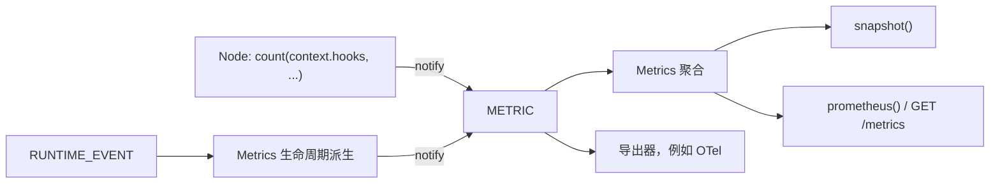

# 第十章：指标与监控

`interlace.metrics` 是官方的进程内指标层。它不引入新的扩展机制：样本是经 Notice 点 `METRIC` 通知的只读值，
聚合器 `Metrics` 是一个普通插件，生命周期指标从已有的 `RUNTIME_EVENT` 派生。基础包仍然零运行时依赖，导入
`interlace` 不会加载本包；OpenTelemetry 桥接按需通过 `interlace-py[otel]` 安装。

指标只用于观察。记录、聚合或导出失败按 Notice 契约记录并隔离，不改变执行结果、`emit()` 结果或执行控制。

## 数据流



全部样本，包括生命周期指标，都经同一个 `METRIC` 点到达聚合器与导出器。第三方插件也可以直接登记
`METRIC` 处理函数，并用作用域键 `name` 只接收某个指标。

## 在 Node 中记录

Node 只有钩子视图 `context.hooks`，`count()` 与 `observe()` 直接接收它：

```python
from interlace import Graph, Node, Output, Runtime
from interlace.metrics import Metrics, count, observe


class Fetch(Node):
    def execute(self, inputs, context):
        count(context.hooks, "crawler.pages", site="example")
        observe(context.hooks, "crawler.page.bytes", 2048, site="example")
        return Output(inputs["default"])


metrics = Metrics()
with Runtime(plugins=[metrics.plugin]) as runtime:
    runtime.register("fetch", Graph(entrypoint="fetch").add(fetch=Fetch()))
    runtime.run("fetch", "https://example.com")
    print(metrics.prometheus())
```

- `count(hooks, name, value=1.0, /, **labels)` 记录非负计数器增量。
- `observe(hooks, name, value, /, **labels)` 记录一次直方图观测，例如以秒为单位的耗时。
- 两个函数的前三个参数是仅限位置参数，因此 `name`、`value` 也可以作为标签名。
- 没有安装任何处理函数时，调用只构造并校验一个 `Metric`，然后由钩子总线立即返回。

`Metric(name, value=1.0, kind="counter", labels={})` 在构造时校验：

| 字段 | 规则 |
| --- | --- |
| `name` | `[a-z][a-z0-9_]*(\.[a-z0-9_]+)*`，例如 `crawler.pages` |
| `value` | 有限实数，规范为 `float`；计数器增量不得为负；`bool` 被拒绝 |
| `kind` | `"counter"` 或 `"histogram"` |
| `labels` | 键匹配 `[a-z_][a-z0-9_]*` 且不以 `__` 开头，值必须是字符串；保存为只读副本 |

## 安装聚合器

`Metrics(*, max_series=1000, exporters=())` 的 `plugin` 属性是不提供 capability 的函数插件，标识为
`interlace.metrics/collector`，因此可以在启动时传入，也可以在运行期安装：

```python
metrics = Metrics()
runtime = Runtime()
handle = runtime.plugin_host.install(metrics.plugin)
...
handle()  # 停止采集，已聚合的数据保留
```

同一 Runtime 只能安装一个 `Metrics` 插件；同一个 `Metrics` 实例可以安装到多个 Runtime，数据在实例内合并。
聚合使用一把锁，每个样本的处理是常数时间。

同一指标名的种类由首个样本确定，之后以另一种类到达的样本被拒绝并记录日志。点替换为下划线后在 Prometheus
中重名的两个指标（例如 `jobs.done` 与 `jobs_done`）同样被拒绝。

## 生命周期指标

`Metrics` 登记 `RUNTIME_EVENT` 处理函数，把以下事实转换为样本：

| 指标 | 种类 | 标签 | 来源 |
| --- | --- | --- | --- |
| `interlace.executions` | counter | graph、status | `execution.finished` |
| `interlace.execution.seconds` | histogram | graph、status | `execution.started` 到 `execution.finished` |
| `interlace.node.firings` | counter | graph、node、status | `node.finished` |
| `interlace.node.seconds` | histogram | graph、node | `node.started` 到 `node.finished` |
| `interlace.works.submitted` | counter | queue | `work.submitted` |
| `interlace.works` | counter | queue、status | `work.finished`，status 为 acked、retried 或 rejected |
| `interlace.events` | counter | event_type | `event.published` |

几点语义：

- 执行指标只覆盖真正开始的 execution；开始前已取消的 Execution 不发布生命周期事件，也就不计数。
- 耗时以 `time.monotonic()` 在处理函数中测量，单位为秒。execution 按 execution_id 配对；同一 execution 的
  Node firing 依次执行，按 (execution_id, node, step) 配对，循环图中的每次 firing 都单独计时。
- 等待配对的开始记录有上限（10000 条），超出时淘汰最早的一条；被淘汰或在插件安装前开始的记录只计数、不计时。
- execution_id 与 work_id 不进入标签。

## 标签与基数

标签只携带有界维度：graph、node、queue、status、event_type 与领域分类。URL、用户 ID、execution ID、Work ID、
Slot ID 等实例标识或业务值会让序列数无限增长，不得作为标签。

`max_series` 是每个指标名最多保存的标签序列数。已有序列继续累加，超出上限的新序列样本被丢弃，丢弃数量由
`metrics.dropped` 给出。上限只约束本地聚合内存，不过滤导出器。

## 快照与 Prometheus 文本

`snapshot()` 返回可 JSON 编码的独立副本，修改它不影响聚合器：

```python
{
    "crawler.pages": {
        "kind": "counter",
        "series": [{"labels": {"site": "example"}, "value": 3.0}],
    },
    "interlace.node.seconds": {
        "kind": "histogram",
        "series": [
            {"labels": {"graph": "fetch", "node": "fetch"}, "count": 3, "sum": 0.02, "max": 0.01}
        ],
    },
}
```

`prometheus()` 按 Prometheus 文本格式 0.0.4 渲染同一份快照：名称中的点替换为下划线，计数器以 `_total` 结尾，
直方图渲染为只含 `_count` 与 `_sum` 的 summary；标签值中的反斜杠、双引号与换行被转义。`max` 只出现在快照中。

```text
# TYPE crawler_pages_total counter
crawler_pages_total{site="example"} 3.0
# TYPE interlace_node_seconds summary
interlace_node_seconds_count{graph="fetch",node="fetch"} 3
interlace_node_seconds_sum{graph="fetch",node="fetch"} 0.02
```

## 服务中的 /metrics

`GraphService.create_app(metrics=...)` 与 `GraphService.serve(metrics=...)` 显式启用 `GET /metrics`，响应类型为
`text/plain; version=0.0.4; charset=utf-8`。该路径与 `/api` 一样受 Bearer 令牌、Host 白名单与同源检查保护，
并带 `Cache-Control: no-store`。未传入 `metrics` 时该路径返回 404。

```python
metrics = Metrics()
with Runtime(plugins=[metrics.plugin]) as runtime, GraphService(runtime) as service:
    service.serve(token="secret", metrics=metrics)
```

Prometheus 抓取配置需要携带同一个令牌，例如 `authorization: {credentials: secret}`。

## OpenTelemetry 桥接

```bash
uv pip install "interlace-py[otel]"
```

`interlace.metrics.otel.otel_exporter(meter)` 返回同步导出函数：每个指标名首次出现时按种类创建一个 Counter 或
Histogram，仪表名保留点分形式，标签作为属性。

```python
from opentelemetry import metrics as otel
from interlace.metrics import Metrics
from interlace.metrics.otel import otel_exporter

metrics = Metrics(exporters=[otel_exporter(otel.get_meter("crawler"))])
```

导出器作为 `METRIC` 处理函数登记在聚合之后，同步收到每个样本，失败由钩子总线记录并隔离。慢速导出器可以包装为
`interlace.plugins.Background(export)` 后传入 `exporters`，移出触发方路径；调用方在 Runtime 关闭后调用其
`close()` 排空队列。未安装 extra 时导入 `interlace.metrics.otel` 抛出带安装提示的 ImportError；导入
`interlace.metrics` 本身从不加载 OpenTelemetry。

## 能力边界

聚合只在当前进程内、按 `Metrics` 实例进行，进程重启即清零。Interlace 不提供跨进程或分布式聚合，不保证
样本投递可靠或精确：Notice 处理函数失败、序列上限与开始记录淘汰都可能使数据不完整。需要跨进程汇总时，
由 Prometheus 抓取每个进程，或由 OpenTelemetry SDK 与 Collector 完成。

## 开发与验证

```bash
uv run pytest tests/metrics -q
uv run --extra service pytest tests/service/test_service_metrics.py -q
uv run --extra service --extra otel mypy interlace
```

[上一章：RPC 与图服务](09-service.md)
